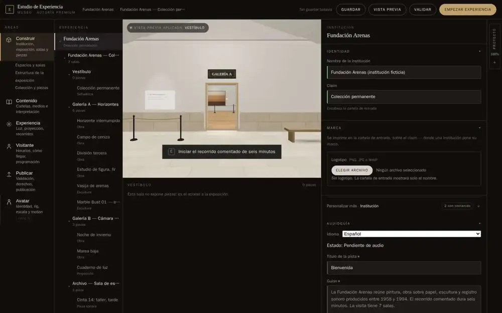
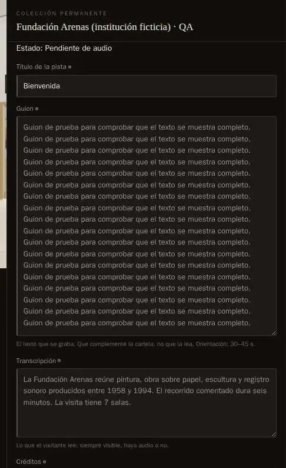
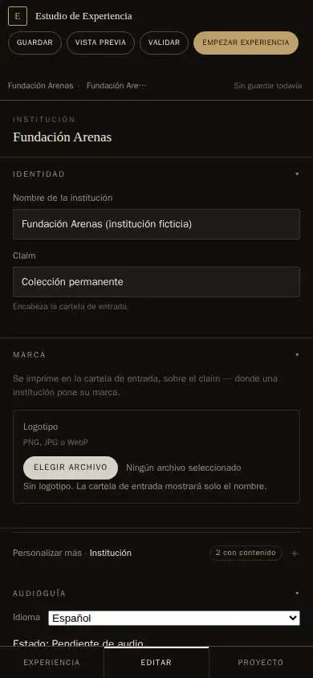

# Evidencia del Studio recuperado

Resultado y método en [STUDIO-LAYOUT-RECOVERY](../../STUDIO-LAYOUT-RECOVERY.md).

El manifiesto documenta las dos pasadas y el código validado. Las capturas no certifican fluidez en teléfono físico.
